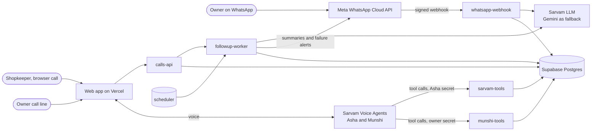

# Easy Recovery AI (prototype)

[](https://github.com/msaimukesh8055-hash/voice-collections/actions/workflows/ci.yml)

## What it is

A WhatsApp-first credit-recovery assistant for a small trader, built as a mock client implementation: requirements, design, build, test, go-live. The trader in the demo is fictional (Srinivas Reddy, Sri Lakshmi Traders, Anantapur) with 100 invented shopkeepers who buy on credit.

- **The owner runs his credit book by chatting on WhatsApp**: who owes what, add credit, record a payment, by text or voice note, in Telugu, Hindi or English.
- **Asha, a voice agent on Sarvam, makes reminder calls.** She remembers earlier calls, takes a promise to pay, and never states an amount before the person confirms who they are.
- **Munshi, a second voice agent, is the owner's call line**: he asks about his book by talking, and every change is read back and confirmed.
- **A follow-up agent** decides what happens after each call and sends the owner a WhatsApp summary.

**The design rule throughout: code first, AI second, the owner last.** Fixed commands are answered in code. The model is asked only when code cannot read a message, and may only suggest. Code checks every figure, name and direction. Nothing touches money until the owner taps Save.

## Architecture



Five Edge Functions, each with its own door check:

| Function | Who calls it | Checked by |
|---|---|---|
| `whatsapp-webhook` | Meta, with the owner's messages | Meta's signature on every request, then the owner's number |
| `sarvam-tools` | Sarvam, when Asha needs a tool | Asha's secret, then a one-time call token |
| `munshi-tools` | Sarvam, when Munshi needs a tool | A different secret and token; Asha's get nothing here |
| `calls-api` | The web app | A signed 24-hour link for the dashboard; one-time tokens for calls |
| `followup-worker` | Our own functions and the scheduler | The worker secret |

Every request to all five is traced step by step into one table, which is what the **Ops** page and the failure alert read. More in `docs/architecture.md` and the decision records in `docs/adr/`.

## Production readiness (M9)

What makes this more than a demo: it can be measured, watched, stopped and explained.

| Question | Answer | Where |
|---|---|---|
| How do you know the AI works? | Asha runs 9 cases on Sarvam Tests plus our own database checks; the WhatsApp brain runs 21 messages; a release gate decides | Dashboard → **Evals**, `evals/` |
| How do you know when it breaks? | Every request is traced step by step; a WhatsApp alert within 5 minutes | Dashboard → **Ops**, `docs/runbook.md` |
| How do you limit the damage? | `/pause` stops every new reminder call in one message | `docs/runbook.md` |
| What stops a bad change? | GitHub runs the full quality gate on every push | `.github/workflows/ci.yml` |
| What does it cost? | About ₹12 a call; voice minutes are 99% of cost | `docs/unit-economics.md` |
| What went wrong so far? | Three money-direction bugs, each stopped at the confirmation card | `docs/incidents/` |
| Who could attack it? | Five doors, each with its own check | `docs/threat-model.md` |
| Explain it in five minutes | One message and one call, end to end | `docs/walkthrough.md` |

**Honest limits:** fake data, one trader, a Meta test number that reaches only registered numbers, calls in a browser (no phone lines), no login. Asha's live prompt (v8) has not been through the eval suite yet; the last measured version (v7) passed the release gate at 17 of 18 behaviours. History and findings are in `docs/milestones/M9.md`.


A WhatsApp-first credit-recovery assistant for a small trader in Anantapur (fake persona: Srinivas Reddy, Sri Lakshmi Traders, ~100 fake shopkeepers). Asha, a reminder voice agent on **Sarvam Voice Agents**, calls shopkeepers in Telugu, Hindi or English. Built on Sarvam + Supabase (Mumbai) + React. **All data is fake.** Scope: [`docs/SPEC.md`](docs/SPEC.md) · Architecture: [`docs/architecture.md`](docs/architecture.md).

## Setup

1. Node 20+ (tested on 25). No global Deno or Docker needed — Deno installs as a project dependency.
2. `npm install`
3. Copy `.env.example` → `.env` and fill it in (never commit `.env`). Supabase project in **ap-south-1 (Mumbai)**. Sarvam needs two keys: `SARVAM_API_KEY` (speech, LLM) and `SARVAM_AGENTS_API_KEY` (Voice Agents, indus.sarvam.ai), plus org and workspace ids. `SARVAM_TOOL_SECRET` is a random 32+ character string you also store in Sarvam's Secrets vault as `easy-recovery-tool-secret`. The WhatsApp bot (M4) needs `META_ACCESS_TOKEN` (system-user token, never expires), `META_PHONE_NUMBER_ID`, `META_WABA_ID`, `META_APP_SECRET`, a random `WHATSAPP_VERIFY_TOKEN`, the owner's number in `OWNER_WHATSAPP_NUMBER` (only number the bot answers; never stored) and `GEMINI_API_KEY` (fallback brain). The follow-up worker (M5) needs `WORKER_SECRET`, another random 32+ character string (calls-api, whatsapp-webhook and munshi-tools send it to wake the worker; pg_cron reads it from Vault, see "Scheduler"). Munshi (M8) needs `MUNSHI_LINK_SECRET` (random 32+ characters, signs the one-time `/munshi` links), `SARVAM_OWNER_TOOL_SECRET` (random 32+ characters, different from `SARVAM_TOOL_SECRET`; also stored in Sarvam's vault as `easy-recovery-owner-tool-secret`) and, once the agent exists, `SARVAM_MUNSHI_APP_ID`.
4. `npm run db:push` — applies migrations + seed to the linked Supabase project.
5. `npm run db:check-seed` — verifies seed counts, Ramesh's figures, his 2 seeded past calls (Asha's call history, M7 B1) and that the browser key cannot read data.
6. `npm run functions:deploy` — uploads function secrets and deploys `sarvam-tools`, `calls-api`, `whatsapp-webhook`, `followup-worker` and `munshi-tools`.
7. `npm run agent:build` — writes `voice-agents/asha/build/agent.json` to create/update Asha in Sarvam (see `voice-agents/README.md`). Put Asha's app id in `SARVAM_APP_ID`, then deploy the functions again. `npm run agent:build -- --agent munshi` does the same for Munshi (`voice-agents/munshi/build/agent.json`, app id in `SARVAM_MUNSHI_APP_ID`).

## Connect WhatsApp (M4)

In Meta → WhatsApp → Configuration set **Callback URL** `https://<project-ref>.supabase.co/functions/v1/whatsapp-webhook` and **Verify token** = `WHATSAPP_VERIFY_TOKEN`, then subscribe to `messages`. Send "hi" from the owner's phone to the test number: the **Menu** list opens every main action with one tap (M7). Commands: `pending`, `closed`, `Ramesh`, `Ramesh 5000 due 15th`, `Ramesh paid 2000`, or free text in Telugu/Hindi/English. A lookup ends with [Remind] [Paid in full] [Part payment]. Every change waits for a **Save** tap.

**Slash commands** (typed with `/`, answered in code): `/munshi`, `/menu`, `/pending`, `/due` (or `/overdue`), `/paid [Ramesh 2000]`, `/add [Ramesh 5000 due 15th]`, `/asha [Ramesh]` (or `/reminder`), `/claims`, `/promises`, `/insights`, `/statement [Ramesh]`; any other `/…` lists them. Typing "call Munshi" (or just "Munshi") anywhere also sends the Munshi link. To show them in WhatsApp's "/" menu run `npm run whatsapp:commands` once (see Commands).

## Try a call

1. `npm run dev`, open `http://localhost:5173/phone` in one Chrome window (allow the microphone) and `http://localhost:5173/` in another.
2. Press **Ring Ramesh** on `/`. The phone page rings; press **Accept** and talk to Asha. No answer in 30 s → missed.

3. When the call ends (or is declined or missed), `followup-worker` sends the owner a WhatsApp summary, usually within a minute; it waits up to 10 minutes for Sarvam's transcript. WhatsApp only delivers it if the owner messaged the bot in the last 24 hours.

To run every waiting follow-up by hand (e.g. after a lost wake-up): `curl -X POST -H "Authorization: Bearer $WORKER_SECRET" https://<project-ref>.supabase.co/functions/v1/followup-worker/sweep` (5 calls per run).

Voice minutes cost ₹3.50/min + GST: use them for manual checks and the demo only. Bulk testing runs as text evals.

## Call Munshi (M8)

Munshi is the owner's own voice line to his book. On WhatsApp: **Menu → 📞 Call Munshi**. The bot replies with a one-time link (`<DASHBOARD_URL>/munshi#t=…`, works once, for 15 minutes; at most 3 links per 10 minutes and 6 Munshi calls a day). Open it in Chrome, tap **Start call** and ask: "how much is pending?", "who is overdue?", "what happened with Ramesh?". Munshi greets in Telugu and follows your language; calls stop at 8 minutes ("1 minute left" from 7:00). He can also add credit, mark a payment (part or full), delete an entry (kept on record as reversed), have Asha remind someone, accept or reject a payment a shopkeeper told Asha about, and get something on WhatsApp: Munshi reads each change back, and the code does it only after his yes. While Munshi is talking, the shopkeeper phone page shows the line as busy and a queued Asha call waits.

## Reminders and simulated calls (M5)

On WhatsApp: `due` or `who is due?` lists broken promises, overdue and due today, with **Remind** buttons (or a list) and **Remind all due**. `remind Ramesh` reminds one person; `remind all` asks "Call N people?" first. Anyone called in the last hour, paused or on do-not-call is skipped, and at most 10 are called per tap. `why is Ramesh 42?` or `Ramesh score` explains the reliability score.

The shopkeeper on the phone page (Ramesh) gets a real voice call. Everyone else gets a **simulated** text call: Asha on `sarvam-105b` talks to a shopkeeper played by Gemini, up to 4 at once, about ₹1 each. Each one gets the same WhatsApp summary, marked simulated.

### Scheduler (pg_cron)

`npm run db:push` applies `20261106000001_reminders.sql`, which turns on `pg_cron` and `pg_net` and schedules three jobs: sweep every minute, promise check at 08:45 IST, due alert at 09:00 IST. The jobs need two Vault secrets. Set them once in the Supabase SQL editor (values from `.env`; do not save the query):

```sql
select vault.create_secret('https://<project-ref>.supabase.co/functions/v1/followup-worker', 'followup_worker_url');
select vault.create_secret('<WORKER_SECRET>', 'worker_secret');
```

Until both exist, each job logs a warning and does nothing. Check runs with `select * from cron.job_run_details order by start_time desc limit 10;`. To stop the jobs: `select cron.unschedule('followup-sweep');` (likewise `daily-promise-check`, `daily-due-alert`).

The daily alert goes out once per demo day. If the owner hasn't messaged the bot in the last 24 hours, WhatsApp only allows an approved template: create a **Utility** template named `daily_due_alert` (English) with body `Good morning. {{1}} shopkeepers are due today. Reply DUE to see them.` Replying DUE gets the full alert.

## Commands

| Command | What it does |
|---|---|
| `npm run dev` | Web dev server (`/` demo controls, `/phone` shopkeeper phone, `/munshi` owner call line) |
| `npm run check` | Full quality gate: format, lint, typecheck, tests + coverage, build, bundle secret scan, Edge Function fmt/lint/check/tests |
| `npm run lint` | ESLint, zero warnings. Also checks the size limits (function ≤ 50 lines, ≤ 3 parameters, file ≤ 800 lines, nesting ≤ 4) on `supabase/functions`; `deno lint` covers the rest there |
| `npm run fn:coverage` | Edge Function coverage report |
| `npm run db:push` | Apply migrations + seed |
| `npm run db:check-seed` | Seed + RLS smoke test |
| `npm run seed:generate` | Regenerate `supabase/seed.sql` from the deterministic generator |
| `npm run functions:deploy` | Upload function secrets, deploy `sarvam-tools`, `calls-api`, `whatsapp-webhook`, `followup-worker`, `munshi-tools` |
| `npm run smoke:tools` | End-to-end check on the deployed functions: ring → accept → 5 tools → ended (no voice credit) |
| `npm run smoke:whatsapp` | Signed fake Meta messages to the deployed webhook: verify, bad signature, stranger. Add `-- --send-to-owner` for pending / lookup / card → Save / duplicate id (**sends real WhatsApp replies to the owner**); cleans up its rows |
| `npm run smoke:reminders` | M5 reminder loop on the deployed functions: worker secret (401/202). Add `-- --send-to-owner` for "due" → Remind tap → one live call queued, then declined (no voice minutes) → follow-up; then one simulated call end to end → follow-up run + note (**sends real WhatsApp messages to the owner, about ₹1 of LLM**); cleans up its rows |
| `npm run smoke:munshi-latency` | M8 latency run on the deployed `munshi-tools` (no voice, no LLM, ₹0): creates a test owner call, runs `book_summary`, `lookup_shopkeeper` and each `prepare_*` + `cancel_action` 20 times (never `confirm_action`, so the book does not change), prints p50 / p95 / max per tool from `owner_tool_events.duration_ms`, fails if any p95 ≥ 500 ms, then marks the test call completed. Needs `SUPABASE_URL`, `SUPABASE_SERVICE_ROLE_KEY`, `SARVAM_OWNER_TOOL_SECRET`. While it runs (~1–2 min) the phone line counts as busy |
| `npm run evals:munshi` | M8 text evals: 15 scripted owner scenarios, Munshi on `sarvam-105b`, owner on Gemini (Sarvam fallback), tools in-process on a fake book (`evals/munshi/book.fixture.ts`), code checks + Gemini judge. Writes `evals/munshi/results/<date>.json`, prints a table, exits 1 unless the pass rule holds. **One full run ≈ ₹10–15 of Sarvam** and ~10–15 minutes (Gemini calls are spaced for the free tier). `-- --dry` = fake models, no network, nothing written; `-- --only 04,06` = just those scenarios. Needs `SARVAM_API_KEY`, `GEMINI_API_KEY` |
| `npm run brand:png` | Render `web/public/brand/logo.svg` to the 640×640 profile PNG (`logo-640.png`, committed) |
| `npm run bot:profile` | Set the bot's WhatsApp profile (logo, About, description, category, website = `DASHBOARD_URL` if https) on the Meta test number. Needs `META_ACCESS_TOKEN`, `META_PHONE_NUMBER_ID` and `META_APP_ID` (App settings → Basic → App ID). Add `-- --dry-run` first: prints the payload, calls nothing |
| `npm run whatsapp:commands` | Register the slash commands (names + English descriptions, from `supabase/functions/_shared/whatsapp/slash-commands.ts`) on the Meta number via conversational automation. Needs `META_ACCESS_TOKEN`, `META_PHONE_NUMBER_ID`. Add `-- --dry` first: prints the payload, calls nothing |
| `npm run agent:build` | Validate Asha's config and render the JSON to push to Sarvam. `-- --agent munshi` for Munshi |
| `npm run agent:record` | Record a committed Sarvam version of Asha in `publishes`. `-- --agent munshi` for Munshi |

## Repository layout

```
web/          demo controls, shopkeeper phone page, Munshi call page (Vite + React + Tailwind, beige / brown / gold theme)
supabase/     migrations, seed, Edge Functions (_shared core, sarvam-tools, calls-api, whatsapp-webhook, followup-worker, munshi-tools)
voice-agents/ voice agents as code (prompt, greetings, voice, languages, tools) — pushed to Sarvam
scripts/      seed generator, deploy, smoke tests, agent build/record
evals/        text evals: munshi/ (M8 C1: scenarios, fake book, checks, judge, runner, results/)
docs/         spec, architecture, ADRs, build log, milestones (plan + results), checkpoint reviews
guidelines/   coding, testing, security, workflow standards
```
